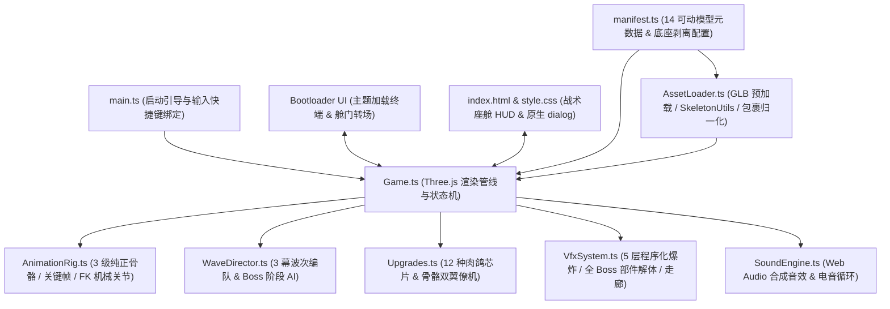

# 《星穹铸舰：千模战役》(STARFORGE: AI ARMADA) 开发计划书

## 1. 项目概览与核心体验

基于 Hugging Face 开源 3D 资产数据集 `scenario-labs/3d-collection`（CC BY 4.0，[项目主页](https://huggingface.co/datasets/scenario-labs/3d-collection)）构建的一款浏览器即开即玩 **Three.js 3D 星际战机肉鸽射击游戏**。

为保证最高战斗表现与动作真实感，本方案对全量 1,342 份开源 GLB 进行了底层节点与骨骼普查：**彻底剔除一切无骨骼、不可分件的单网格静态雕塑（`nodes=1` 全部清零）**，仅精选原生带有 **`SkinnedMesh` 蒙皮骨骼、多轨关键帧动画或清晰父子级机械关节**的开源模型入库。

### 核心设计三支柱
1. **追尾高速走廊射击手感（类《星际火狐》）**
   - 镜头紧随战机后方沿深空走廊高速推进，支持 **鼠标跟随** 与 **WASD / 方向键** 双模无缝控制，搭配二阶弹簧阻尼侧倾（Roll / Pitch）物理惯性与双层预测准星。
   - 内置 **滚筒翻滚（Barrel Roll，右键 / Shift）**：提供 `0.46s` 无敌帧并可直接弹反敌方弹幕；**阵营超频大招（空格 / Q）** 带来高光清屏时刻。
2. **AI 造船厂机库 + 原始 Prompt 溯源铭牌**
   - 开局 3D 旋转展台机库提供 **GPT-6 Astra 3D**、**Claude Opus 5.5 3D** 以及两款 **GPT-6 Astra 3D-to-3D 骨骼与多轨变形** 四大可动战机切换预览（支持鼠标拖拽观察旋翼、起落架、折翼与舵面的实时运作）。
   - 机库侧边栏与全 3 幕关底重型 Boss 登场告警条会实时展示该 3D 资产的 **AI 生成模型徽章** 与 **原始英文 Prompt**，兼顾可玩性与开源 AI 动画拓扑对比话题度。
3. **紧凑 3 幕战役 + 波次三选一肉鸽芯片 + 无尽模式**
   - 单局约 **4~5 分钟**，横跨「轨道城峡谷 → 碎星跃迁门廊 → 龙骨母舰空域」3 个风格迥异的 3D 走廊关卡与 3 尊多关节可解体巨型 Boss。
   - 每波间隙通过原生 `<dialog>` 弹出 **三选一战术强化芯片**（含召唤具备真实螺旋桨骨骼动画的双翼护航僚机）；通关第 3 幕母舰后可选择直接结算或跃迁进入 **无尽深空模式** 冲分。

> [!NOTE]
> **当前工程进度（v1.3 深度审计修复 & 自动化 E2E 验证体系）**：在 v1.2 全量 Phase 1–5 代码与 `public/ui/icons` **21 枚**透明图标/徽章/勋章落盘基础上，v1.3 对引擎管线、战斗玩法、UI 响应式与无障碍进行了全面审计加固：
> - **引擎与资产管线**：[AssetLoader.ts](./src/engine/AssetLoader.ts) 扩展 `warmPools(..., extraWarmupObjects)` 并在 `initCorridorProps()` 前预编译 VFX 着色器，补齐 `UI_PRELOAD_URLS` 全量 26 项图标/UI 预加载与对象池视觉重置防护；[AnimationRig.ts](./src/engine/AnimationRig.ts) 将 `prop_gate` 开启触发提前至 `z >= -165`（`timeScale = 1.65`）适配高速推进；[SoundEngine.ts](./src/engine/SoundEngine.ts) 确保无头/锁定音频上下文安全降级。
> - **玩法与 VFX**：[VfxSystem.ts](./src/game/VfxSystem.ts) 暴露预热网格并将 6 枚爆炸点光源预挂载于容器避免战中 `NUM_POINT_LIGHTS` 重编译；[WaveDirector.ts](./src/game/WaveDirector.ts) 修正星门 Y 轴归零对齐与 Boss `detachQueue` 祖先节点去重；[Game.ts](./src/game/Game.ts) / [Upgrades.ts](./src/game/Upgrades.ts) / [SaveStore.ts](./src/game/SaveStore.ts) 补齐 `ship_aero` +15% 基础暴击与 16m 折射紫光弹射、`ship_morph` +1 基础穿透、Boss 击杀即刻清弹/3s 无敌与 `rawDt` 驱动的 1.8s 慢动作解体、无尽模式持久化及 `window.__STARFORGE__` QA 遥测接口。
> - **UI / CSS 与 `<dialog>` 合规**：[index.html](./index.html) 与 [style.css](./src/style.css) 将 `.boot-screen` 背景切换为相对路径 `` 兼容 `base: './'` 子路径部署，配置相对路径 `./ui/logo_emblem.png` 站点图标消除 `/favicon.ico` 404，全部静态 `` 补充 `width`/`height` 防 CLS，严格落实原生 `<dialog>` + `showModal()`、`dialog:modal` / `dialog::backdrop` `overscroll-behavior: contain`、仅 `dialog[open]` 布局作用域、高对比 `:focus-visible` 焦点环与 `:active` 按压反馈，并优化 `1440×900` 与 `1280×720` 双分辨率零溢出零遮挡布局。
> - **无头 E2E 自动化回归**：新增 `tests/headless-e2e.mjs`（`npm run test:e2e`），基于 `playwright-core` 与 `vite preview` 面向 `dist/` 执行 8 阶段全链路 WebGL 渲染、三选一弹窗、三幕 Boss 破部位、无尽模式与 `1280×720` 响应式校验。

---

## 2. 系统架构与目录规划

### 核心模块关系图



### 源码与资源目录规划

```text
starforge-3d/
├── PLAN.md                             # 本开发计划书留档
├── docs/
│   └── ui_concept_hud_hangar.png       # 机库概念风格参考图（不随 dist 打包）
├── index.html                          # 主题启动加载舱（相对路径背景图与显式尺寸）、战术座舱 HUD、原生 <dialog> 弹窗
├── package.json                        # Vite + TypeScript + Three.js + gltf-transform + playwright-core (test:e2e)
├── scripts/
│   └── fetch-and-optimize-models.mjs   # Hugging Face 14 资产下载（保护骨骼/关键帧，仅转换 WebP 贴图）
├── tests/
│   └── headless-e2e.mjs                # 基于 playwright-core + vite preview 的 8 阶段无头 Chrome WebGL E2E 回归套件
├── public/
│   ├── draco/                          # 本地化 Draco 解码器（零外部 CDN 依赖）
│   ├── models/                         # 14 个全精度可动/带骨骼本地 .glb 资产（85.81 MB）
│   └── ui/                             # Codex 战术重工 UI 背景原画、透明边框（5 件）与裁切图标集
│       └── icons/                      # 两批透明图集一次生成 + 自动裁切的 21 枚 256×256 透明小图标与徽章勋章
└── src/
    ├── main.ts                         # 入口引导启动
    ├── style.css                       # 战术遥测风样式、1280×720/1440×900 响应式布局、dialog:modal 滚动遏制与焦点规范
    ├── assets/
    │   └── manifest.ts                 # 14 个模型 URL、AI 来源、原始 Prompt、底座/罐体剥离与 Boss 可破坏部位
    ├── engine/
    │   ├── AssetLoader.ts              # SkeletonUtils 克隆、静态子网格无损合批、对象池预热与 compileAsync
    │   ├── AnimationRig.ts             # 3 级纯正骨骼与机械关节驱动（SkinnedMesh / 百轨锁帧 / FK）
    │   └── SoundEngine.ts              # 零外部音频依赖的 Web Audio 合成音效与背景律动
    └── game/
        ├── SaveStore.ts                # localStorage 单舰战绩、通关耗时与静音偏好持久化存档
        ├── Upgrades.ts                 # 12 种战术肉鸽芯片池与数值叠加计算
        ├── VfxSystem.ts                # 5 层程序化爆炸、Boss 实时/终结真实子部件解体、闪电链
        ├── WaveDirector.ts             # 3 幕波次脚本、全息加速环、无尽模式难度曲线与可破部位 Boss 生成
        └── Game.ts                     # 主循环、机库展台相机、追尾空战物理、Boss 部位优先判定与 HUD/弹窗交互
```

---

## 3. 已入库的 14 个全可动 / 带骨骼开源 3D 模型清单（实测拆包数据）

所有资产均 **100% 保留原始三角面几何精度**，且针对带骨骼（`skins > 0`）或关键帧动画（`animations > 0`）的 GLB，脚本严格跳过 `prune` 与 `dedup` 以防止骨架末端节点（如 `prop_end_joint`）或轨道绑定丢失；其余静帧机械组装件均启用 `prune({ keepLeaves: true })`。

实测入库统计：**`0` 个单网格静态雕塑（全部节点数 `>= 16`）**｜**`9` 个模型自带原生关键帧动画（共 `129` 条轨道）**｜**`3` 套真实 `SkinnedMesh` 蒙皮骨骼**｜总本地体积 **`85.81 MB`**。

| 本地文件名 | 游戏定位 | AI 生成模型 | 体积 | 三角面数 | 节点数 | 原生动画 / 蒙皮骨骼 | 核心可动关节与层级实测 |
| :--- | :--- | :--- | ---: | ---: | ---: | :--- | :--- |
| `ship_astra.glb` | 玩家战机 · 日曜四旋翼穿梭机 | GPT-6 Astra 3D | 1.27 MB | 28,945 | 29 | 程序化 FK | 4 台独立旋翼 `Rotor_FL..RR`、前后翼、座舱盖 `Cockpit_Canopy`、起落滑撬 `Landing_Skid_L/R` |
| `ship_opus.glb` | 玩家战机 · 铁砧倾转旋翼突击舰 | Claude Opus 5.5 3D | 1.28 MB | 31,028 | 21 | **8 段动画** | `Wing_L/R`→`Nacelle_L/R`→`Rotor_L/R` 倾转旋翼链、前后腿 `Leg_*`、可开合 `Canopy` 与 `RearHatch` |
| `ship_morph.glb` | 玩家战机 · 苍穹百轨变形截击舰 | GPT-6 Astra · 3D-to-3D | 12.56 MB | 256,430 | 483 | **103 段动画** | 完整液压起落架、4 扇舱门铰链 `Arm bay door` 与折叠外翼风扇全套机械变形序列 |
| `ship_aero.glb` | 玩家战机 · 疾风气动重型战机 | GPT-6 Astra · 3D-to-3D | 1.99 MB | 62,416 | 33 | **4 段动画** + FK | 原生独立铰链副翼 `Aileron_L/R` 与升降舵 `Elevator_L/R`，外加独立前部 `Propeller` 螺旋桨 |
| `boss_act1_mech.glb` | 第 1 幕 Boss · 铁幕四足重炮机甲 | Claude Opus 5.5 3D | 2.70 MB | 42,512 | 22 | 程序化 FK | `Hull`→`Turret`→`Turret_Gun` 联动炮塔、`Cannon_L/R`、4 条 `Upper`→`Lower`→`Foot` 三段机械腿 |
| `boss_act2_crab.glb` | 第 2 幕 Boss · 深渊巨钳螃蟹机甲 | Claude Opus 5.5 3D | 2.17 MB | 79,382 | 17 | 程序化 FK | 六足 `Leg_L1..L3`/`R1..R3`、双臂与可咬合子钳 `Claw_L/R`→`Claw_*_Pincer`、双天线与复眼 |
| `boss_act3_carrier.glb` | 第 3 幕 Boss · 龙骨桁架星际母舰 | Claude Opus 5.5 3D | 2.77 MB | 33,488 | 25 | 程序化 FK | 剥离展示底座 `Stand_*` 后，保留 `DorsalTurret`、`BowCraneArms` 及 12 架独立甲板舰载机 |
| `enemy_drone.glb` | 杂兵 · 折叠天线侦察机 | GPT-6 Astra 3D | 1.69 MB | 18,837 | 19 | **1 段动画** + FK | 原生 `Antenna` 展开动画、`Turret \| optical head` 光学云台、六轮悬架组 |
| `enemy_turret.glb` | 杂兵 · 骨骼联动防空炮塔 | GPT-6 Astra · 3D-to-3D | 11.40 MB | 154,028 | 28 | **1 段(75通道)** / **`skins=1`** | 真实 `SkinnedMesh` 骨骼蒙皮：底座静止，上部炮塔左右 45° 巡航扫射并带动 13 根柔性电缆弯曲 |
| `enemy_rover.glb` | 精英 · 五轴机械臂突击车 | GPT-6 Astra · 3D-to-3D | 11.66 MB | 311,217 | 40 | **7 段动画** + FK | `ARM J0` 底座偏航 → `J1` 大臂 → `J2` 肘部 → `J3` 腕部 → `J4` 双指抓手，外加 6 轮独立悬架 |
| `enemy_foldwing.glb` | 精英 · 80° 折翼重型截击机 | GPT-6 Astra · 3D-to-3D | 3.21 MB | 99,752 | 209 | **2 段动画** + FK | `WingFold_Pivot_L/R` 80° 折叠储藏/展开变翼动画、机械铰链螺栓细节与前部螺旋桨 |
| `ally_biplane.glb` | 召唤物 · 骨骼旋翼护航僚机 | GPT-6 Astra · 3D-to-3D | 1.20 MB | 26,496 | 32 | **1 段(12通道)** / **`skins=1`** | 真实 `SkinnedMesh` 蒙皮：`prop_joint` / `body_joint` 骨骼驱动螺旋桨高速循环并伴随机身微震 |
| `prop_city_tile.glb` | 第 1 幕走廊 · 科幻城市区块 | Claude Opus 5.5 3D | 9.90 MB | 122,924 | 16 | 模块化建筑组件 | `Tower_Tall_A/B`、`Skybridge_A_B`、`Walkway_*` 等 16 个可拆解科幻楼群与天桥 |
| `prop_gate.glb` | 第 2/3 幕走廊 · 骨骼机械跃迁星门 | GPT-6 Astra · 3D-to-3D | 22.01 MB | 232,280 | 67 | **2 段(85通道)** / **`skins=1`** | 真实 `SkinnedMesh` 蒙皮：六辐手轮转动 → 12 根 `dog lock` 锁舌活塞回缩 → 门板旋转 70° 敞开 |

---

## 4. 玩法内容设计明细

### A. 四大 AI 造船厂可动战机

| 战机名称 | 所属 AI 阵营 | 主武器弹道特性 | 超频大招（空格 / Q） | 机械动画与数值定位 |
| :--- | :--- | :--- | :--- | :--- |
| **日曜四旋翼穿梭机** (`X-01`) | GPT-6 Astra 3D | 高频双联脉冲激光，弹道极稳 | **轨道离子过载光束**：释放持续 `2.5s` 贯穿全屏的金色巨型光柱，焚毁路径敌弹并高频灼烧敌机 | 4 台涵道旋翼依航速实时变频旋转，侧倾联动滑撬/座舱姿态；均衡全能首选（100 HP） |
| **铁砧倾转旋翼突击舰** (`C-55`) | Claude Opus 5.5 3D | 三向扇形重型电浆炮，覆盖面大 | **电磁护盾新星**：瞬间回复 `30` 点护盾，并将全场所有敌弹转化为追踪敌机的友方反击导弹 | 原生 8 段旋翼倾转短舱与舱门动画随转向实时联动；最高护盾坦度（135 HP） |
| **苍穹百轨变形截击舰** (`A-103`) | GPT-6 Astra · 3D-RIG | 极速穿甲磁轨双炮，可贯穿首名目标 | **幻影齐射风暴**：瞬间齐射 `18` 枚高爆追踪导弹，全向清场并重创 Boss 部位 | 触发 103 轨折翼展开与起落架舱门收放变形动画；极高机动与最短翻滚冷却（90 HP） |
| **疾风气动重型战机** (`G-08`) | GPT-6 Astra · AERO-RIG | 高暴击折射激光机炮（命中弹射邻近敌人） | **棱镜时空缓速场**：全场敌机与敌弹减速 `70%` 持续 `4s`，期间全武器必定暴击 | 4 段独立铰链副翼 `Aileron` 与升降舵 `Elevator` 随键鼠转向反向偏转 + 螺旋桨疾转（100 HP） |

### B. 三幕战役与多关节 Boss 机制

1. **第 1 幕 · 轨道城峡谷（ACT I: Orbital Metropolis）**
   - **走廊场景**：深蓝夜空下，两侧高速掠过成排模块化的 `prop_city_tile.glb` 科幻城市大楼、天桥与霓虹光柱。
   - **敌群节奏**：`enemy_drone.glb`（展开雷达天线并旋转光学云台索敌）编队 + `enemy_turret.glb`（75 通道骨骼蒙皮防空塔带柔性电缆实时扭转扫射），波间空投一次三选一芯片。
   - **关底 Boss**：`boss_act1_mech.glb`（**铁幕四足重炮机甲** · Claude Opus 5.5 3D）— 四条三段铰接机械腿交替踏步横移，`Turret->Turret_Gun` 实时锁定玩家位置倾泻扇形重炮与双轨红线狙击光束，`Cannon_L/R` 交替发射后坐力回弹。
2. **第 2 幕 · 碎星跃迁门廊（ACT II: Fractured Warp Gateway）**
   - **走廊场景**：紫雾深空，玩家驾机高速穿过矗立的 `prop_gate.glb`（**67 节点骨骼蒙皮重型装甲门**）— 当星门进入 `z >= -165m` 触发区间时，以 `1.65x` 速率完整播放手轮转动 → 12 枚锁舌活塞回缩 → 70° 大门液压开启动画，供战机疾驰穿越。
   - **敌群节奏**：`enemy_rover.glb`（俯冲平台携带五轴机械臂展开锁定投弹）与 `enemy_foldwing.glb`（巡航叠翼形态接近中距后触发 `WingFold` 80° 展开双翼齐射）混编强袭。
   - **关底 Boss**：`boss_act2_crab.glb`（**深渊巨钳螃蟹机甲** · Claude Opus 5.5 3D）— 六足正弦交替步态横移、蓄力举起 `Claw_L/R` 驱动子钳 `Claw_*_Pincer` 咔嚓开合，发射螺旋弹幕阵列与可弹反等离子球。
3. **第 3 幕 · 龙骨母舰空域（ACT III: Crimson Dreadnought Citadel）**
   - **走廊场景**：深红警示恒星光晕与高频电流脉冲星尘，重装 `enemy_foldwing`、`enemy_rover` 与 `enemy_turret` 前哨阵地联合伏击。
   - **终极 Boss**：`boss_act3_carrier.glb`（**龙骨桁架星际母舰** · Claude Opus 5.5 3D）— 自动剔除展示底座后悬浮压阵；`DorsalTurret` 背部主炮台实时追踪玩家，`BowCraneArms` 二阶段张开，甲板上 12 架真实舰载机（`Fighter_Port1..6` / `Stbd1..6`）逐架脱离母舰升空化作无人机编队俯冲攻击。击败后弹出凯旋结算面板，可选择跃迁进入 **无尽深空模式** 或返回机库换舰重开。

### C. 战地三选一肉鸽芯片池（12 种）

1. **骨骼旋翼护航僚机**（召唤带 `skins=1` 原生螺旋桨骨骼动画的 `ally_biplane.glb` 3D 僚机编队伴飞点射）
2. **智能追踪导弹舱**（每隔数次主炮射击自动齐射追踪导弹，优先锁定高威胁敌机与 Boss 部位）
3. **分叉散射棱镜**（主武器额外增加 `+2` 条侧向扩散弹道）
4. **穿甲电磁轨道**（主武器贯穿次数 `+1` 且初速提升 `22%`）
5. **偏转能量矩阵**（延长翻滚无敌帧并反弹敌弹追踪回击）
6. **特斯拉电弧链**（命中敌人概率触发跳跃 3~5 个目标的高压连锁闪电）
7. **聚变超载核心**（暴击率 `+18%`、暴击伤害额外 `+35%`）
8. **纳米自愈护盾**（最大护盾上限 `+30` 并立刻恢复，脱战后每秒再生 `3.5` 点护盾）
9. **急速冷却芯片**（射速提速 `+20%`，终极充能效率 `+25%`）
10. **矢量过载喷口**（移速 `+16%`，战场维修/能量掉落球磁吸半径大幅扩增）
11. **机动翻滚旋风**（翻滚冷却缩短 `24%`，且每次触发翻滚向前甩出一轮 6 发扇形散弹）
12. **超频核能共鸣器**（充能获取效率再增幅 `+35%`，并立刻获得 `+40%` 大招充能）

---

## 5. 主题启动加载舱设计 (Starforge Bootloader)

针对 **`85.81 MB` 全精度骨骼与多轨动画资产包** 的浏览器预加载，打造极具仪式感且零等待焦虑的 **「星穹铸舰 · 轨道启动终端」**：

1. **视觉与氛围**：以 Codex 生成的 `./ui/bootloader_bg.png`（通过相对路径 `` 渲染以适配 Vite `base: './'` 子路径部署）为全屏深空船坞装甲闸门基底，顶部叠加 `./ui/logo_emblem.png`（`STARFORGE` 透明徽标），实时显示当前加载百分比（等宽字体 `JetBrains Mono`）与分段式工业能量进度条；机库与战斗阶段分别复用 `./ui/hud_visor_frame.png` 座舱外框、`./ui/hud_reticle_compass.png` 预测准星罗盘与 `./ui/card_chip_frame.png` 芯片卡框。
2. **AI 资产注入实时日志流**：在加载过程中依次动态滚动每一条带骨骼/动画指标的遥测日志，例如：
   - `[03/14] RIGGING GPT-6 ASTRA // ship_morph.glb (103 anim tracks) ... OK`
   - `[09/14] BINDING SKINNED MESH // enemy_turret.glb (75ch cable+swivel) ... OK`
   - `[14/14] LOCKING VAULT SKELETON // prop_gate.glb (12 dog-locks, 85ch) ... OK`
3. **WebGL 着色器静默预热**：在 14 个模型全部进内存并完成 `Box3` 包裹测量后（进度 96%→100%），后台自动调用 `renderer.compileAsync(scene, camera)` 预编译所有 PBR 蒙皮、机械关节与爆炸噪声着色器，彻底消灭首帧卡顿。
4. **舱门滑开仪式感转场**：进度达到 `100%` 时，按钮点亮为脉冲态 **「初始化神经接驳 · ENTER HANGAR」**；玩家点击后同步激活 `AudioContext` 音效引擎，随后上下两扇厚重星舰装甲舱门向两侧滑开，平滑切入 3D 造船厂机库。

---

## 6. 纯正骨骼与机械关节驱动 & 5 层爆炸解体方案

### A. 3 级纯正骨骼与机械关节驱动体系（`AnimationRig.ts`）

放弃对静态单网格模型做顶点偏移伪装的妥协做法，所有入库单位均遵循 **真实骨架蒙皮、原生关键帧轨道、清晰父子机械链** 三级精确驱动：

| 驱动层级 | 适用模型 | 具体实现方案 | 战斗与机库表现 |
| :--- | :--- | :--- | :--- |
| **L1：原生 `SkinnedMesh` 蒙皮骨骼动画** | `enemy_turret`（`skins=1`, 75 通道）<br>`ally_biplane`（`skins=1`, 12 通道）<br>`prop_gate`（`skins=1`, 85 通道） | 通过 `SkeletonUtils.clone` 完整复制骨骼矩阵与绑定关系，由 `AnimationMixer` 驱动骨骼动画：<br>- **防空炮塔**：炮塔随扫描周期平稳转动，13 根电缆随骨骼权重大幅自然弯曲摆动；<br>- **护航僚机**：螺旋桨骨骼 `prop_joint` 循环疾转并伴随机身震动；<br>- **跃迁星门**：战机接近时单次正向触发 4 秒开闸动画，穿过门洞 | 与商业 3D 引擎标准一致的骨骼蒙皮形变与时序触发 |
| **L2：原生 `AnimationMixer` 多轨机械关键帧** | `ship_morph`（103 段动画）<br>`ship_opus`（8 段动画）<br>`ship_aero`（4 段动画）<br>`enemy_rover`（7 段动画）<br>`enemy_foldwing`（2 段动画）<br>`enemy_drone`（1 段动画） | 根据实机游戏状态智能切换与混合 `AnimationAction` 权重/播放进度：<br>- **变形截击舰 & 突击舰**：机库悬停展示全套机翼折叠/起落架展开动画；出击或翻滚时滑入战斗展翼构型；<br>- **气动战机**：随玩家滚筒侧倾/俯仰动态插值驱动 `Aileron_L/R` 与 `Elevator_L/R`；<br>- **机械臂车 / 折翼机 / 侦察机**：接敌进入射程时自动展开五轴机械臂、80° 舒展双翼与雷达天线 | 机械结构与驾驶操作实时咬合，丝滑变身、拒绝僵硬移动 |
| **L3：正向动力学（FK）父子机械关节驱动** | `boss_act1_mech`（22 节点）<br>`boss_act2_crab`（17 节点）<br>`boss_act3_carrier`（25 节点）<br>`ship_astra`（29 节点） | 解析并绑定原模型高精度语义化父子关节链：<br>- **四足 Boss**：4 条 `Upper`→`Lower`→`Foot` 三段关节按对角步态协调踏步，`Turret` 水平追踪玩家、双肩炮 `Cannon_L/R` 开火后坐力回弹；<br>- **螃蟹 Boss**：`Leg_L1..R3` 六足律动，双钳 `Claw` + `Pincer` 蓄力夹击；<br>- **母舰 Boss**：`DorsalTurret` 瞄准追踪、`BowCraneArms` 二阶段张开、`Fighter_*` 真实离舰出击；<br>- **日曜穿梭机**：4 台独立涵道旋翼 `Rotor_FL..RR` 变频高速旋转 | 精准的部位索敌、机械步态与开火后坐力物理回弹 |

### B. 5 层电影级程序化爆炸 + 全 3 幕 Boss 真实子部件解体（`VfxSystem.ts`）

所有击毁爆炸均采用 **5 层空间叠加管线**：

1. **第 1 层 · 白炽闪光核 + 动态点光源脉冲**：爆炸前 `0.06s` 爆发刺眼闪光核并激活随时间衰减的动态 `PointLight`，让周围金属战机壳体与建筑同步映出火光反射，联动 `UnrealBloomPass` 形成炫光。
2. **第 2 层 · 双层菲涅尔超音速冲击波环**：两道交叉倾斜的环形冲击波（Additive Blending + 菲涅尔边缘高亮 Shader）在 `0.35s` 内急速扩张稀释。
3. **第 3 层 · 噪声溶解体积火球与冷却黑烟**：自定义 GLSL **程序化噪声溶解火球 Shader**，按时间与 3D 噪声阈值呈现 **「白炽内核 → 炽热亮橙 → 暗红余烬 → 炭黑浓烟碎裂消散」** 热力学演变。
4. **第 4 层 · 3D 物理装甲碎片与拉长速度火花**：`InstancedMesh` 抛射 20+ 块旋转金属碎片与 30 余道速度方向拉伸电弧火花。
5. **第 5 层 · 全 3 幕 Boss 慢动作连环殉爆 & 真实 3D 子部件崩飞解体**：由于本次剔除了一体化泥塑、精选了全多部件机构，**第 1~3 幕全部 3 尊 Boss** 均可执行 `1.8s` 慢动作连环殉爆：机身各处爆出 6~8 团连锁火球后，直接将 `Turret`、`Cannon_L/R`、`Leg_*`、`Claw_L/R`、`DorsalTurret`、`BowCraneArms` 等 **真实 3D 子节点**脱离父级束缚，赋予径向爆破初速度与高速翻滚角速度向深空四周崩飞解体！

---

## 7. 关键技术防坑方案

1. **防篡改外层包裹器 `Box3` 归一化**：实测 14 个模型原始尺跨度达 **近 3000 倍**——`ally_biplane.glb` 仅 `0.003 × 0.002 × 0.001` 米，而 `ship_morph.glb` 达 `8.870 × 7.023 × 7.284` 米。`AssetLoader.ts` 通过外层包裹容器 `wrapperGroup` 承担中心归零与 `targetSize` 缩放，**绝不直接修改自带骨骼或关键帧的模型根节点本地变换**，以免破坏 `AnimationMixer` 关键帧偏移。
2. **`SkeletonUtils.clone` 与受击闪光隔离**：所有模型实例均使用 `three/examples/jsm/utils/SkeletonUtils.js` 的 `clone()` 复制（保证 `SkinnedMesh` 骨骼矩阵独立绑定）；同时独立克隆受击材质引用，严禁污染缓存共享材质。
3. **自动剥离展示底座节点**：在 `AssetLoader.ts` 归一化前先识别并移除配置中指定的展示台（如 `boss_act3_carrier` 的 `Stand_DisplayBase` 与 `Stand_Pylons`），避免底座影响母舰中心计算与空中悬浮观感。
4. **PBR 金属材质防发黑 & 朝向实机校准**：使用 `PMREMGenerator` 烘焙 `RoomEnvironment` 环境反射贴图 + 三点光，并在浏览器实机逐一校准每个模型的 `orientation: { yaw, pitch, roll }` 朝向。
5. **现代 Web UI 与零依赖音效**：芯片选卡、暂停与结算面板均使用原生 `<dialog>` + `showModal()`（不叠加冗余 `role="dialog"` / `aria-modal`，仅在 `dialog[open]` 设置布局样式，并通过 `dialog:modal` 与 `dialog::backdrop` 的 `overscroll-behavior: contain` 遏制底层滚动链），全交互控件具备 `:focus-visible` 焦点环与 `:active` 按压反馈，支持键鼠与 `1 / 2 / 3` 快捷键；Web Audio API 实时合成激光、导弹、弹反、爆炸、Boss 警报及可一键静音的背景电音。
6. **透明小图标合集批裁规范**：所有同类 UI 透明小图标统一采用「单张网格透明图集一次生成 + Alpha 连通域自动裁切居中导出」规范（如 `4×3` 图集 `81.98s` 一次产齐 12 枚 `256×256` RGBA 透明 PNG 并落盘至 `public/ui/icons/`），风格绝对统一且节省约 9 倍生图耗时。

---

## 8. 分阶段开发里程碑（Milestones）

| 阶段 | 核心交付内容 | 验收标准 |
| :--- | :--- | :--- |
| **Phase 1：启动加载舱与骨骼无损管线** | 编写 `AssetLoader.ts`（`SkeletonUtils.clone`、底座节点剥离、包裹器 `Box3` 归一化与 `compileAsync` 预热），实现「星穹铸舰启动终端」与装甲舱门开合转场 | 14 个高精度可动模型 100% 加载成功，实时骨骼/轨道日志滚动流畅，点击进入无首帧卡顿 |
| **Phase 2：3 级纯正动画系统与 3D 机库** | 实现 `AnimationRig.ts`（L1 `SkinnedMesh` 蒙皮、L2 `AnimationMixer` 百轨机械变形、L3 FK 父子机械腿与炮塔联动），搭好可拖拽的 4 战机机库与 Prompt 铭牌 | 四架战机在展台展示各自真实旋翼/折翼/起落架/舵面动作，切换秒开、朝向正确、金属通透 |
| **Phase 3：高速走廊飞行与 5 层爆炸特效** | 实现追尾推进相机、键鼠双模移动侧倾（实时联动副翼与短舱）、双层预测准星、自动/手动开火、滚筒翻滚无敌弹反、4 阵营大招与 5 层程序化爆炸 | 可流畅穿梭射击、弹反敌弹、释放大招，击毁爆破具备闪光/冲击波/黑烟/碎片层次 |
| **Phase 4：三幕战役、全 Boss 解体与肉鸽芯片** | 接入 3 幕走廊（城市块 / 85 通道骨骼跃迁星门）、4 类可动敌军、3 尊 Boss 步态炮塔 AI 与 1.8s 慢动作子部件崩飞解体、原生 `<dialog>` 12 种芯片与无尽模式 | 完整走通 3 幕可动 Boss 战、部件崩飞解体演出、芯片三选一（含骨骼螺旋桨僚机）与无尽模式 |
| **Phase 5：音效打磨与自动化无头 E2E 验收** | 接入 `SoundEngine.ts` 合成音效与电音循环；完成 v1.3 管线/玩法/UI 响应式审计；编写 `tests/headless-e2e.mjs`（`playwright-core` + `vite preview` 实测 `dist/`）并检验 `1440×900` 与 `1280×720` | 构建零报错、HTTP 404/Console 零错误、加载页/机库 4 舰/战斗被动与大招/三选一弹窗/Boss 破部位/凯旋无尽模式与 6 张实机截图验收全部通过 |
