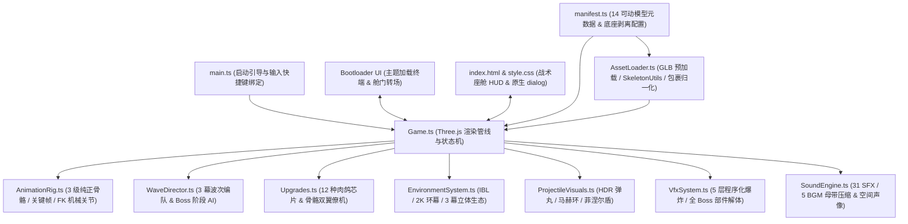

# 《星穹战翼：破晓远征》(STARFORGE: ECLIPSE VANGUARD) 开发计划书

## 1. 项目概览与核心体验

基于开源 3D 资产数据集 `scenario-labs/3d-collection`（CC BY 4.0，[项目主页](https://huggingface.co/datasets/scenario-labs/3d-collection)）作为底层工程素材库构建的一款浏览器即开即玩 **Three.js 3D 星际战机肉鸽射击游戏**（游戏内全面采用原创破晓远征军工世界观呈现，无任何出戏元术语）。

为保证最高战斗表现与动作真实感，本方案在工程选型阶段对全量 1,342 份开源 GLB 进行了底层节点与骨骼普查：**彻底剔除一切无骨骼、不可分件的单网格静态雕塑（`nodes=1` 全部清零）**，仅精选原生带有 **`SkinnedMesh` 蒙皮骨骼、多轨关键帧动画或清晰父子级机械关节**的资产入库。

### 核心设计三支柱
1. **追尾高速走廊射击手感（类《星际火狐》）**
   - 镜头紧随战机后方沿深空走廊高速推进，支持 **鼠标跟随** 与 **WASD / 方向键** 双模无缝控制，搭配二阶弹簧阻尼侧倾（Roll / Pitch）物理惯性与双层预测准星。
   - 内置 **滚筒翻滚（Barrel Roll，右键 / Shift）**：提供 `0.46s` 无敌帧并可直接弹反敌方弹幕；**阵营超频大招（空格 / Q）** 带来高光清屏时刻。
2. **轨道整备机库 + 军工阵营战术档案**
   - 开局 **AEGIS 轨道指挥部 07 号星港机库** 提供 **赫利俄斯航宇 (`X-01`)**、**伏尔甘重工 (`C-55`)**、**瓦尔基里特装 (`A-103`)** 与 **暴风气动院 (`G-08`)** 四大阵营战机切换预览（支持鼠标拖拽全方位检视旋翼、起落架、折翼与舵面的实时运作）。
   - 机库侧边栏展示战机所属军工铭牌与 **机体战术档案（TACTICAL ARCHIVE）**；全 3 幕关底重型 Boss 告警条实时展示 **威胁评级（`THREAT LV.4 / LV.5 / OMEGA`）** 与 **战术情报（破坏部位指引）**。
3. **紧凑 3 幕战役 + 波次三选一肉鸽芯片 + 无尽模式**
   - 单局约 **4~5 分钟**，横跨「轨道城峡谷 → 碎星跃迁门廊 → 龙骨母舰空域」3 个风格迥异的 3D 走廊关卡与 3 尊多关节可解体巨型 Boss。
   - 每波间隙通过原生 `<dialog>` 弹出 **三选一战术强化芯片**（含召唤双翼护航僚机）；通关第 3 幕母舰肃清破晓航道后可选择直接结算或跃迁进入 **无尽深空模式** 冲分。

> [!NOTE]
> **当前工程进度（v5.0 街机弹幕级立体声音频 & v4.3 硬件识别与 4K 性能优化）**：在 v4.3 全界面实时 FPS、4K Auto-DRS 与硬件参数识别五档分辨率的基础上，v5.0 全面重构音频系统为街机弹幕级混合母带管线与分场景动态配乐架构，现已通过 8 阶段 `247` 项自动化断言：
> - **混合音频获取与 ElevenLabs SFX v3 生产管线（[fetch-and-generate-audio.mjs](./scripts/fetch-and-generate-audio.mjs) + `public/audio/`）**：优先拉取 OpenGameArt CC0 5 首分场景 BGM（`bgm_hangar`、`bgm_act1/2/3`、`bgm_boss`）与 Kenney CC0 18 组高频射击/命中/弹反/小爆炸/UI 音效；缺失的 13 组核心签名战斗音效（中型/Boss 级核爆、部位击碎电弧、Boss 三连红警 Klaxon 警报、四战机专属大招、翻滚音爆、护盾受击、模块装配锁入及凯旋/失联 Fanfare）经 `.env` 调用 ElevenLabs `eleven_text_to_sound_v3` 合成（共消耗 `264 / 10,000` 额度），并统一由 FFmpeg 转码裁剪至 `44.1kHz 128kbps` MP3。
> - **Web Audio 母带引擎与全流程声学联动（[SoundEngine.ts](./src/engine/SoundEngine.ts) + [Game.ts](./src/game/Game.ts)）**：采用 `DynamicsCompressorNode` 总线防爆音压限、跨轨 BGM 平滑交叉淡入淡出（`setBgmTrack`）、暂停/升级弹窗 `680Hz` 低通闷音（`setMuffled`）、大招/警报/Boss 殉爆自动侧链闪避（`duckBgm`）、双采样交替微变调、`1.0x..8.0x` 连击升调与 `StereoPannerNode` 左右声道定位，并保留离线振荡器合成兜底。
> - **v4.2 / v4.3 4K 与硬件自选底座（[index.html](./index.html) + [style.css](./src/style.css) + [SaveStore.ts](./src/game/SaveStore.ts)）**：完整保留 Top-Layer `#fps-hud[popover="manual"]`、WebGL GPU/CPU/内存/4K 屏识别及 `智能适配 / 720P / 1080P / 2K / 原生4K` 五档切换、DPR `0.25..2` 像素预算、Auto-DRS、Half-Res Bloom 与零逐帧模糊优化。
> - **全链路 247 断言 E2E（[tests/headless-e2e.mjs](./tests/headless-e2e.mjs)）**：全面验证 `31/31` SFX 与 `5/5` BGM 解码无报错、机库/Act1/Boss/结算 Stinger/无尽模式曲目自动切换、弹窗闷音开合同步以及 `3840×2160` 4K 五档分辨率精准切换，`247` 项断言 100% 通过。

---

## 2. 系统架构与目录规划

### 核心模块关系图



### 源码与资源目录规划

```text
starforge-3d/
├── PLAN.md                             # 本开发计划书留档
├── docs/
│   └── ui_concept_hud_hangar.png       # 机库概念风格参考图（不随 dist 打包）
├── index.html                          # 主题启动加载舱（相对路径背景图与显式尺寸）、战术座舱 HUD、原生 <dialog> 弹窗
├── package.json                        # Vite + TypeScript + Three.js + gltf-transform + playwright-core (test:e2e)
├── scripts/
│   ├── fetch-and-optimize-models.mjs   # Hugging Face 14 资产下载（保护骨骼/关键帧，仅转换 WebP 贴图）
│   └── fetch-and-generate-audio.mjs    # CC0 音频拉取 + ElevenLabs SFX v3 生成 + FFmpeg 44.1kHz 母带处理（npm run fetch-audio）
├── tests/
│   └── headless-e2e.mjs                # 基于 playwright-core + vite preview 的 8 阶段（247 断言，含全链路音频、硬件识别五档分辨率与 FPS）无头 Chrome WebGL E2E 回归套件
├── public/
│   ├── audio/                          # v5.0 母带级街机音效与动态配乐（5 首 CC0 BGM + 18 组 CC0 + 13 组 ElevenLabs SFX v3）
│   ├── draco/                          # 本地化 Draco 解码器（零外部 CDN 依赖）
│   ├── env/                            # 4 张 1920×1080 WebP 机库/三幕全景远景贴图
│   ├── models/                         # 14 个全精度可动/带骨骼本地 .glb 资产（85.81 MB）
│   └── ui/                             # UI 背景原画、定制外框与裁切图标集
│       ├── frames/                     # v4.1 定制 7 套透明倒角重工 UI 外框 WebP（panel/modal/slot_cyan/slot_amber/launch_amber/hud_status/hud_boss）
│       └── icons/                      # 21 枚 256×256 透明小图标与徽章勋章
└── src/
    ├── main.ts                         # 入口引导启动
    ├── style.css                       # 战术遥测风样式、1280×720/1440×900 响应式布局、dialog:modal 滚动遏制与焦点规范
    ├── assets/
    │   └── manifest.ts                 # 14 个模型 URL、bootLog 同步日志、4 大阵营档案 loreDesc、Boss 威胁评级/战术情报、ACT_THEMES 与破部位配置
    ├── engine/
    │   ├── AssetLoader.ts              # SkeletonUtils 克隆、静态子网格无损合批、全景贴图预载、对象池预热与 compileAsync
    │   ├── AnimationRig.ts             # 3 级纯正骨骼与机械关节驱动（SkinnedMesh / 百轨锁帧 / FK）
    │   └── SoundEngine.ts              # 31 组 SFX / 5 首动态 BGM 交叉淡入淡出、母带压限、侧链闪避、低通闷音与左右声像引擎（含合成兜底）
    └── game/
        ├── SaveStore.ts                # localStorage 单舰战绩、通关耗时、静音与 graphicsPreset（auto/720p/1080p/1440p/native）持久化存档
        ├── Upgrades.ts                 # 12 种战术肉鸽芯片池与数值叠加计算
        ├── EnvironmentSystem.ts        # RoomEnvironment IBL、GLSL 天穹、2K 弧形环幕、机库栈桥与 3 幕差异化 3D 生态
        ├── ProjectileVisuals.ts        # HDR 弹道光束、追踪导弹烟迹、敌军戒环弹幕、枪口焰、马赫环与六边形护盾
        ├── VfxSystem.ts                # 5 层程序化爆炸、HDR 火花针、Boss 实时/终结真实子部件解体、闪电链
        ├── WaveDirector.ts             # 3 幕波次脚本、按幕城市块显隐控制、全息加速环、无尽模式与可破部位 Boss 生成
        └── Game.ts                     # 硬件参数探测、5 档精确分辨率缩放 + Auto-DRS、EffectComposer + Half-Res UnrealBloomPass、全界面 FPS/硬件面板与 HUD/弹窗交互
```

---

## 3. 已入库的 14 个全可动 / 带骨骼开源 3D 模型清单（实测拆包数据）

所有资产均 **100% 保留原始三角面几何精度**，且针对带骨骼（`skins > 0`）或关键帧动画（`animations > 0`）的 GLB，脚本严格跳过 `prune` 与 `dedup` 以防止骨架末端节点（如 `prop_end_joint`）或轨道绑定丢失；其余静帧机械组装件均启用 `prune({ keepLeaves: true })`。

实测入库统计：**`0` 个单网格静态雕塑（全部节点数 `>= 16`）**｜**`9` 个模型自带原生关键帧动画（共 `129` 条轨道）**｜**`3` 套真实 `SkinnedMesh` 蒙皮骨骼**｜总本地体积 **`85.81 MB`**。

| 本地文件名 | 游戏定位 | AI 生成模型 | 体积 | 三角面数 | 节点数 | 原生动画 / 蒙皮骨骼 | 核心可动关节与层级实测 |
| :--- | :--- | :--- | ---: | ---: | ---: | :--- | :--- |
| `ship_astra.glb` | 玩家战机 · 日曜四旋翼穿梭机 | GPT-6 Astra 3D | 1.27 MB | 28,945 | 29 | 程序化 FK | 4 台独立旋翼 `Rotor_FL..RR`、前后翼、座舱盖 `Cockpit_Canopy`、起落滑撬 `Landing_Skid_L/R` |
| `ship_opus.glb` | 玩家战机 · 铁砧倾转旋翼突击舰 | Claude Opus 5.5 3D | 1.28 MB | 31,028 | 21 | **8 段动画** | `Wing_L/R`→`Nacelle_L/R`→`Rotor_L/R` 倾转旋翼链、前后腿 `Leg_*`、可开合 `Canopy` 与 `RearHatch` |
| `ship_morph.glb` | 玩家战机 · 苍穹百轨变形截击舰 | GPT-6 Astra · 3D-to-3D | 12.56 MB | 256,430 | 483 | **103 段动画** | 完整液压起落架、4 扇舱门铰链 `Arm bay door` 与折叠外翼风扇全套机械变形序列 |
| `ship_aero.glb` | 玩家战机 · 疾风气动重型战机 | GPT-6 Astra · 3D-to-3D | 1.99 MB | 62,416 | 33 | **4 段动画** + FK | 原生独立铰链副翼 `Aileron_L/R` 与升降舵 `Elevator_L/R`，外加独立前部 `Propeller` 螺旋桨 |
| `boss_act1_mech.glb` | 第 1 幕 Boss · 铁幕四足重炮机甲 | Claude Opus 5.5 3D | 2.70 MB | 42,512 | 22 | 程序化 FK | `Hull`→`Turret`→`Turret_Gun` 联动炮塔、`Cannon_L/R`、4 条 `Upper`→`Lower`→`Foot` 三段机械腿 |
| `boss_act2_crab.glb` | 第 2 幕 Boss · 深渊巨钳螃蟹机甲 | Claude Opus 5.5 3D | 2.17 MB | 79,382 | 17 | 程序化 FK | 六足 `Leg_L1..L3`/`R1..R3`、双臂与可咬合子钳 `Claw_L/R`→`Claw_*_Pincer`、双天线与复眼 |
| `boss_act3_carrier.glb` | 第 3 幕 Boss · 龙骨桁架星际母舰 | Claude Opus 5.5 3D | 2.77 MB | 33,488 | 25 | 程序化 FK | 剥离展示底座 `Stand_*` 后，保留 `DorsalTurret`、`BowCraneArms` 及 12 架独立甲板舰载机 |
| `enemy_drone.glb` | 杂兵 · 折叠天线侦察机 | GPT-6 Astra 3D | 1.69 MB | 18,837 | 19 | **1 段动画** + FK | 原生 `Antenna` 展开动画、`Turret \| optical head` 光学云台、六轮悬架组 |
| `enemy_turret.glb` | 杂兵 · 骨骼联动防空炮塔 | GPT-6 Astra · 3D-to-3D | 11.40 MB | 154,028 | 28 | **1 段(75通道)** / **`skins=1`** | 真实 `SkinnedMesh` 骨骼蒙皮：底座静止，上部炮塔左右 45° 巡航扫射并带动 13 根柔性电缆弯曲 |
| `enemy_rover.glb` | 精英 · 五轴机械臂突击车 | GPT-6 Astra · 3D-to-3D | 11.66 MB | 311,217 | 40 | **7 段动画** + FK | `ARM J0` 底座偏航 → `J1` 大臂 → `J2` 肘部 → `J3` 腕部 → `J4` 双指抓手，外加 6 轮独立悬架 |
| `enemy_foldwing.glb` | 精英 · 80° 折翼重型截击机 | GPT-6 Astra · 3D-to-3D | 3.21 MB | 99,752 | 209 | **2 段动画** + FK | `WingFold_Pivot_L/R` 80° 折叠储藏/展开变翼动画、机械铰链螺栓细节与前部螺旋桨 |
| `ally_biplane.glb` | 召唤物 · 骨骼旋翼护航僚机 | GPT-6 Astra · 3D-to-3D | 1.20 MB | 26,496 | 32 | **1 段(12通道)** / **`skins=1`** | 真实 `SkinnedMesh` 蒙皮：`prop_joint` / `body_joint` 骨骼驱动螺旋桨高速循环并伴随机身微震 |
| `prop_city_tile.glb` | 第 1 幕走廊 · 科幻城市区块 | Claude Opus 5.5 3D | 9.90 MB | 122,924 | 16 | 模块化建筑组件 | `Tower_Tall_A/B`、`Skybridge_A_B`、`Walkway_*` 等 16 个可拆解科幻楼群与天桥 |
| `prop_gate.glb` | 第 2/3 幕走廊 · 骨骼机械跃迁星门 | GPT-6 Astra · 3D-to-3D | 22.01 MB | 232,280 | 67 | **2 段(85通道)** / **`skins=1`** | 真实 `SkinnedMesh` 蒙皮：六辐手轮转动 → 12 根 `dog lock` 锁舌活塞回缩 → 门板旋转 70° 敞开 |

---

## 4. 玩法内容设计明细

### A. 四大军工阵营可动战机

| 战机名称 | 所属军工阵营 | 主武器弹道特性 | 超频大招（空格 / Q） | 机构动画与数值定位 |
| :--- | :--- | :--- | :--- | :--- |
| **日曜四旋翼穿梭机** (`X-01`) | 赫利俄斯航宇 (`SOLARIS AEROSPACE`) | 高频双联脉冲激光，弹道极稳 | **轨道离子过载光束**：释放持续 `2.5s` 贯穿全屏的金色巨型光柱，焚毁路径敌弹并高频灼烧敌机 | 4 台涵道旋翼依航速实时变频旋转，侧倾联动滑撬/座舱姿态；均衡全能首选（100 HP） |
| **铁砧倾转旋翼突击舰** (`C-55`) | 伏尔甘重工 (`VULCAN HEAVY`) | 三向扇形重型电浆炮，覆盖面大 | **电磁护盾新星**：瞬间回复 `30` 点护盾，并将全场所有敌弹逆转为追踪敌机的友方反击导弹 | 倾转旋翼短舱与舱门随转向实时联动；最高护盾坦度（135 HP） |
| **苍穹可变翼截击舰** (`A-103`) | 瓦尔基里特装 (`VALKYRIE SKUNKWORKS`) | 极速穿甲磁轨双炮，自带 `+1` 穿透 | **幻影齐射风暴**：瞬间齐射 `18` 枚高爆追踪导弹，全向清场并重创 Boss 部位 | 折叠外翼展开与起落架舱门收放变形联动；极高机动与最短翻滚冷却（90 HP） |
| **疾风气动重型战机** (`G-08`) | 暴风气动院 (`TEMPEST DYNAMICS`) | 高暴击折射激光机炮（`+15%` 暴击，命中弹射邻近敌人） | **棱镜时空缓速场**：全场敌机与敌弹减速 `70%` 持续 `4s`，期间全武器必定暴击 | 全动铰链副翼 `Aileron` 与升降舵 `Elevator` 随键鼠转向反向偏转 + 螺旋桨疾转（100 HP） |

### B. 三幕战役与多关节 Boss 机制

1. **第 1 幕 · 轨道城峡谷（ACT I: Orbital Metropolis）**
   - **走廊场景**：日照云海与双环行星天穹下，装甲面板高架台面承载 `prop_city_tile.glb` 科幻城市大楼与天桥，两侧高速流光塔群与光轨交织。
   - **敌群节奏**：前哨侦察无人机编队 + 骨骼联动防空炮塔协同扫射，波间空投一次三选一芯片。
   - **关底 Boss**：**铁幕四足重炮机甲**（`威胁 IV 级 · 重装要塞`）— 四条三段铰接机械腿交替踏步横移，`Turret->Turret_Gun` 实时锁定玩家位置倾泻扇形重炮，左右肩炮 `Cannon_L/R` 可优先摧毁以瓦解交叉火力封锁。
2. **第 2 幕 · 碎星跃迁门廊（ACT II: Fractured Warp Gateway）**
   - **走廊场景**：离子晶簇星云与跃迁等离子河之间矗立 `prop_gate.glb` 重型装甲星门，进入 `z >= -165m` 区间时以 `1.65x` 速率完整播放手轮转动 → 锁舌活塞回缩 → 70° 大门液压开启动画。
   - **敌群节奏**：机械臂突击平台与 80° 折翼高速截击机混编强袭。
   - **关底 Boss**：**深渊巨钳螃蟹机甲**（`威胁 V 级 · 裂隙机兵`）— 六足正弦交替步态横移，双侧电弧巨钳 `Claw_L/R` 蓄力夹击，集中火力击碎巨钳可阻断高能等离子齐射。
3. **第 3 幕 · 龙骨母舰空域（ACT III: Crimson Dreadnought Citadel）**
   - **走廊场景**：恒星熔炉炽红天穹下穿梭于巨型战舰熔核甲板与多层阶梯装甲隔舱战壕之间，重装防空火力联合伏击。
   - **终极 Boss**：**龙骨桁架星际母舰**（`终极威胁 · 封锁旗舰`）— 悬浮压阵并由 `DorsalTurret` 追踪火力压制、`BowCraneArms` 配合甲板舰载机编队俯冲投送；优先击破背脊防空主炮与舰首投射臂可瘫痪其投送与防空网。击败后弹出凯旋结算面板，可选择跃迁进入 **无尽深空模式** 或返回机库换舰重开。

### C. 战地三选一肉鸽芯片池（12 种）

1. **双翼护航僚机**（召唤无人双翼僚机编队伴飞护航，与主炮同步协同点射前方敌群）
2. **智能追踪导弹舱**（每隔数次主炮射击自动齐射追踪导弹，优先锁定高威胁敌机与 Boss 部位）
3. **分叉散射棱镜**（主武器额外增加 `+2` 条侧向扩散弹道）
4. **穿甲电磁轨道**（主武器贯穿次数 `+1` 且初速提升 `22%`）
5. **偏转能量矩阵**（延长翻滚无敌帧并反弹敌弹追踪回击）
6. **特斯拉电弧链**（命中敌人概率触发跳跃 3~5 个目标的高压连锁闪电）
7. **聚变超载核心**（暴击率 `+18%`、暴击伤害额外 `+35%`，高能爆裂直击瞬间瓦解敌阵）
8. **纳米自愈护盾**（最大护盾上限 `+30` 并立刻恢复，脱战后每秒再生 `3.5` 点护盾）
9. **急速冷却芯片**（射速提速 `+20%`，终极充能效率 `+25%`）
10. **矢量过载喷口**（移速 `+16%`，战场维修/能量掉落球磁吸半径大幅扩增）
11. **机动翻滚旋风**（翻滚冷却缩短 `24%`，且每次触发翻滚向前甩出一轮 6 发扇形散弹）
12. **超频核能共鸣器**（充能获取效率再增幅 `+35%`，并立刻获得 `+40%` 大招充能）

---

## 5. 轨道启动终端设计 (Starforge Bootloader)

针对高精度全可动舰队资产与 2K 全景天幕包的浏览器预加载，打造极具仪式感且零等待焦虑的 **「星穹战翼 · 轨道打击终端」**：

1. **视觉与氛围**：以 `./ui/bootloader_bg.png`（通过相对路径 `` 渲染以适配 Vite `base: './'` 子路径部署）为全屏星港装甲闸门基底，顶部叠加 `./ui/logo_emblem.png`（`STARFORGE: ECLIPSE VANGUARD` 透明徽标），实时显示同步百分比（等宽字体 `JetBrains Mono`）与工业能量进度条；机库与战斗阶段分别复用 `./ui/hud_visor_frame.png` 座舱外框、`./ui/hud_reticle_compass.png` 预测准星罗盘与 `./ui/card_chip_frame.png` 芯片卡框。
2. **世界观遥测同步日志流**：加载过程依次滚动 14 条沉浸式战备同步日志（`[SYNC]` / `[INTEL]` / `[RADAR]` / `[LINK]` / `[NAV]`），例如：
   - `[SYNC] X-01 日曜四旋翼穿梭机 · 四联涵道矢量推进阵列校准就绪`
   - `[INTEL] 第 3 战区旗舰级目标特征已载入：龙骨桁架星际母舰`
   - `[OK] 战术座舱全息视界、星际天幕与火控罗盘同步完成`
   - `[READY] 聚变反应堆点火就绪 · 全舰队武装与跃迁引擎待命`
3. **WebGL 着色器静默预热**：在 14 个模型、4 张全景贴图与 21 枚 UI 图标进内存并完成归一化后（进度 96%→100%），后台自动调用 `renderer.compileAsync(scene, camera)` 预编译全部 PBR 蒙皮、天穹生态、HDR 弹道与爆炸着色器，彻底消灭首帧卡顿。
4. **舱门滑开仪式感转场**：进度达到 `100%` 时，按钮点亮为脉冲态 **「进入星港机库 · ENTER HANGAR」**；玩家点击后同步激活 `AudioContext` 音效引擎，上下两扇星港装甲舱门向两侧滑开，平滑切入 3D 轨道整备机库。

---

## 6. 纯正骨骼与机械关节驱动 & 5 层爆炸解体方案

### A. 3 级纯正骨骼与机械关节驱动体系（`AnimationRig.ts`）

放弃对静态单网格模型做顶点偏移伪装的妥协做法，所有入库单位均遵循 **真实骨架蒙皮、原生关键帧轨道、清晰父子机械链** 三级精确驱动：

| 驱动层级 | 适用模型 | 具体实现方案 | 战斗与机库表现 |
| :--- | :--- | :--- | :--- |
| **L1：原生 `SkinnedMesh` 蒙皮骨骼动画** | `enemy_turret`（`skins=1`, 75 通道）<br>`ally_biplane`（`skins=1`, 12 通道）<br>`prop_gate`（`skins=1`, 85 通道） | 通过 `SkeletonUtils.clone` 完整复制骨骼矩阵与绑定关系，由 `AnimationMixer` 驱动骨骼动画：<br>- **防空炮塔**：炮塔随扫描周期平稳转动，13 根电缆随骨骼权重大幅自然弯曲摆动；<br>- **护航僚机**：螺旋桨骨骼 `prop_joint` 循环疾转并伴随机身震动；<br>- **跃迁星门**：战机接近时单次正向触发 4 秒开闸动画，穿过门洞 | 与商业 3D 引擎标准一致的骨骼蒙皮形变与时序触发 |
| **L2：原生 `AnimationMixer` 多轨机械关键帧** | `ship_morph`（103 段动画）<br>`ship_opus`（8 段动画）<br>`ship_aero`（4 段动画）<br>`enemy_rover`（7 段动画）<br>`enemy_foldwing`（2 段动画）<br>`enemy_drone`（1 段动画） | 根据实机游戏状态智能切换与混合 `AnimationAction` 权重/播放进度：<br>- **变形截击舰 & 突击舰**：机库悬停展示全套机翼折叠/起落架展开动画；出击或翻滚时滑入战斗展翼构型；<br>- **气动战机**：随玩家滚筒侧倾/俯仰动态插值驱动 `Aileron_L/R` 与 `Elevator_L/R`；<br>- **机械臂车 / 折翼机 / 侦察机**：接敌进入射程时自动展开五轴机械臂、80° 舒展双翼与雷达天线 | 机械结构与驾驶操作实时咬合，丝滑变身、拒绝僵硬移动 |
| **L3：正向动力学（FK）父子机械关节驱动** | `boss_act1_mech`（22 节点）<br>`boss_act2_crab`（17 节点）<br>`boss_act3_carrier`（25 节点）<br>`ship_astra`（29 节点） | 解析并绑定原模型高精度语义化父子关节链：<br>- **四足 Boss**：4 条 `Upper`→`Lower`→`Foot` 三段关节按对角步态协调踏步，`Turret` 水平追踪玩家、双肩炮 `Cannon_L/R` 开火后坐力回弹；<br>- **螃蟹 Boss**：`Leg_L1..R3` 六足律动，双钳 `Claw` + `Pincer` 蓄力夹击；<br>- **母舰 Boss**：`DorsalTurret` 瞄准追踪、`BowCraneArms` 二阶段张开、`Fighter_*` 真实离舰出击；<br>- **日曜穿梭机**：4 台独立涵道旋翼 `Rotor_FL..RR` 变频高速旋转 | 精准的部位索敌、机械步态与开火后坐力物理回弹 |

### B. 5 层电影级程序化爆炸 + 全 3 幕 Boss 真实子部件解体（`VfxSystem.ts`）

所有击毁爆炸均采用 **5 层空间叠加管线**：

1. **第 1 层 · 白炽闪光核 + 动态点光源脉冲**：爆炸前 `0.06s` 爆发刺眼闪光核并激活随时间衰减的动态 `PointLight`，让周围金属战机壳体与建筑同步映出火光反射，联动 `UnrealBloomPass` 形成炫光。
2. **第 2 层 · 双层菲涅尔超音速冲击波环**：两道交叉倾斜的环形冲击波（Additive Blending + 菲涅尔边缘高亮 Shader）在 `0.35s` 内急速扩张稀释。
3. **第 3 层 · 噪声溶解体积火球与冷却黑烟**：自定义 GLSL **程序化噪声溶解火球 Shader**，按时间与 3D 噪声阈值呈现 **「白炽内核 → 炽热亮橙 → 暗红余烬 → 炭黑浓烟碎裂消散」** 热力学演变。
4. **第 4 层 · 3D 物理装甲碎片与拉长速度火花**：`InstancedMesh` 抛射 20+ 块旋转金属碎片与 30 余道速度方向拉伸电弧火花。
5. **第 5 层 · 全 3 幕 Boss 慢动作连环殉爆 & 真实 3D 子部件崩飞解体**：由于本次剔除了一体化泥塑、精选了全多部件机构，**第 1~3 幕全部 3 尊 Boss** 均可执行 `1.8s` 慢动作连环殉爆：机身各处爆出 6~8 团连锁火球后，直接将 `Turret`、`Cannon_L/R`、`Leg_*`、`Claw_L/R`、`DorsalTurret`、`BowCraneArms` 等 **真实 3D 子节点**脱离父级束缚，赋予径向爆破初速度与高速翻滚角速度向深空四周崩飞解体！

---

## 7. 关键技术防坑方案

1. **防篡改外层包裹器 `Box3` 归一化**：实测 14 个模型原始尺跨度达 **近 3000 倍**——`ally_biplane.glb` 仅 `0.003 × 0.002 × 0.001` 米，而 `ship_morph.glb` 达 `8.870 × 7.023 × 7.284` 米。`AssetLoader.ts` 通过外层包裹容器 `wrapperGroup` 承担中心归零与 `targetSize` 缩放，**绝不直接修改自带骨骼或关键帧的模型根节点本地变换**，以免破坏 `AnimationMixer` 关键帧偏移。
2. **`SkeletonUtils.clone` 与受击闪光隔离**：所有模型实例均使用 `three/examples/jsm/utils/SkeletonUtils.js` 的 `clone()` 复制（保证 `SkinnedMesh` 骨骼矩阵独立绑定）；同时独立克隆受击材质引用，严禁污染缓存共享材质。
3. **自动剥离展示底座节点**：在 `AssetLoader.ts` 归一化前先识别并移除配置中指定的展示台（如 `boss_act3_carrier` 的 `Stand_DisplayBase` 与 `Stand_Pylons`），避免底座影响母舰中心计算与空中悬浮观感。
4. **PBR 金属材质防发黑 & 朝向实机校准**：使用 `PMREMGenerator` 烘焙 `RoomEnvironment` 环境反射贴图 + 三点光，并在浏览器实机逐一校准每个模型的 `orientation: { yaw, pitch, roll }` 朝向。
5. **现代 Web UI 与零依赖音效**：芯片选卡、暂停与结算面板均使用原生 `<dialog>` + `showModal()`（不叠加冗余 `role="dialog"` / `aria-modal`，仅在 `dialog[open]` 设置布局样式，并通过 `dialog:modal` 与 `dialog::backdrop` 的 `overscroll-behavior: contain` 遏制底层滚动链），全交互控件具备 `:focus-visible` 焦点环与 `:active` 按压反馈，支持键鼠与 `1 / 2 / 3` 快捷键；Web Audio API 实时合成激光、导弹、弹反、爆炸、Boss 警报及可一键静音的背景电音。
6. **透明小图标合集批裁规范**：所有同类 UI 透明小图标统一采用「单张网格透明图集一次生成 + Alpha 连通域自动裁切居中导出」规范（如 `4×3` 图集 `81.98s` 一次产齐 12 枚 `256×256` RGBA 透明 PNG 并落盘至 `public/ui/icons/`），风格绝对统一且节省约 9 倍生图耗时。

---

## 8. 分阶段开发里程碑（Milestones）

| 阶段 | 核心交付内容 | 验收标准 |
| :--- | :--- | :--- |
| **Phase 1：启动加载舱与骨骼无损管线** | 编写 `AssetLoader.ts`（`SkeletonUtils.clone`、底座节点剥离、包裹器 `Box3` 归一化与 `compileAsync` 预热），实现「星穹铸舰启动终端」与装甲舱门开合转场 | 14 个高精度可动模型 100% 加载成功，实时骨骼/轨道日志滚动流畅，点击进入无首帧卡顿 |
| **Phase 2：3 级纯正动画系统与 3D 机库** | 实现 `AnimationRig.ts`（L1 `SkinnedMesh` 蒙皮、L2 `AnimationMixer` 百轨机械变形、L3 FK 父子机械腿与炮塔联动），搭好可拖拽的 4 战机轨道机库与阵营战术档案 | 四架战机在展台展示各自真实旋翼/折翼/起落架/舵面动作，切换秒开、朝向正确、金属通透 |
| **Phase 3：高速走廊飞行与 5 层爆炸特效** | 实现追尾推进相机、键鼠双模移动侧倾（实时联动副翼与短舱）、双层预测准星、自动/手动开火、滚筒翻滚无敌弹反、4 阵营大招与 5 层程序化爆炸 | 可流畅穿梭射击、弹反敌弹、释放大招，击毁爆破具备闪光/冲击波/黑烟/碎片层次 |
| **Phase 4：三幕战役、全 Boss 解体与肉鸽芯片** | 接入 3 幕走廊（城市块 / 85 通道骨骼跃迁星门）、4 类可动敌军、3 尊 Boss 步态炮塔 AI 与 1.8s 慢动作子部件崩飞解体、原生 `<dialog>` 12 种芯片与无尽模式 | 完整走通 3 幕可动 Boss 战、部件崩飞解体演出、芯片三选一（含双翼护航僚机）与无尽模式 |
| **Phase 5：音频重铸、v2.0~v5.0 改造与 E2E 验收** | 完成 v1.3 审计、v2.0 天穹生态/HDR 泛光/弹道升级、v3.0 沉浸世界观、v4.0/v4.1 机库与 HUD 重铸、v4.2/v4.3 全界面 FPS 与硬件识别五档分辨率，以及 v5.0 `SoundEngine.ts` + `fetch-and-generate-audio.mjs` 31 SFX / 5 BGM 街机弹幕立体声重铸；`tests/headless-e2e.mjs`（247 断言）覆盖 `1440×900`/`1280×720`/`3840×2160` 4K、五档分辨率切换、全链路音频解锁与切曲、全界面 FPS 胶囊、零 `"//"` 与沉浸纯净度校验 | 构建零报错、HTTP 404/Console 零错误、全链路 247 断言通过、无任何出戏元术语或 `"//"` 泄露与 7 张实机截图验收全部通过 |
