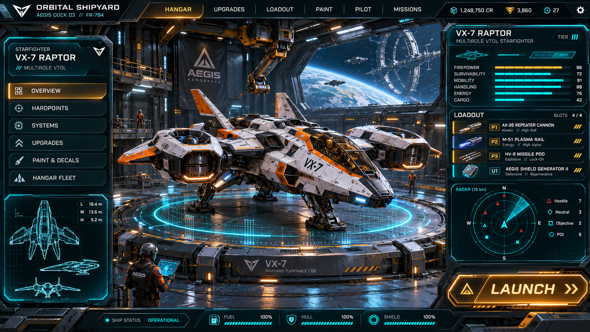

# 《星穹铸舰：千模战役》(STARFORGE: AI ARMADA)

基于开源 3D 模型数据集 [`scenario-labs/3d-collection`](https://huggingface.co/datasets/scenario-labs/3d-collection) 与 **Three.js + TypeScript + Vite** 构建的浏览器即开即玩 **3D 星际战机走廊肉鸽射击游戏**。

> **100% 真骨骼与多关节可动资产**：所有入库 14 份 GLB 资产均拒绝静态单网格雕塑（零 `nodes=1` 泥塑），完整保留原生 `SkinnedMesh` 蒙皮骨骼、多轨关键帧动画及清晰的父子机械关节链，在 3D 机库与关底 Boss 告警条中实时展示模型 AI 来源徽章与原始英文生成 Prompt。



---

## 核心特性

- **14 款可动 / 带骨骼开源 3D 资产**
  - 涵盖 4 架玩家可操纵战机、3 尊多关节可破部位关底 Boss、4 类敌军单位、1 架 `SkinnedMesh` 螺旋桨护航僚机，以及轨道城区块 / 85 通道骨骼蒙皮机械跃迁星门。
  - 通过 `SkeletonUtils.clone`、静态子网格合并、外层 `Box3` 归一化包裹器与 `compileAsync` + 首帧着色器预热，保障切换秒开与流畅帧率。
- **四大阵营战机与专属被动 / 大招**
  - **日曜四旋翼穿梭机 (`X-01`)**（GPT-6 Astra 3D）：四涵道旋翼变频旋转；主武器高频双联脉冲激光；大招 **轨道离子过载光束**（`2.5s` 贯穿光柱清弹并高频灼烧）。
  - **铁砧倾转旋翼突击舰 (`C-55`)**（Claude Opus 5.5 3D）：8 段原生倾转短舱与舱门动画；三向电浆扇面；大招 **电磁护盾新星**（回复护盾并将全屏敌弹转化为追踪导弹）。
  - **苍穹百轨变形截击舰 (`A-103`)**（GPT-6 Astra · 3D-to-3D）：103 段液压折翼/舱门关键帧；主炮自带 `+1` 基础穿透；大招 **幻影齐射风暴**（18 枚追踪导弹齐射）。
  - **疾风气动重型战机 (`G-08`)**（GPT-6 Astra · 3D-to-3D）：副翼 `Aileron` 与升降舵 `Elevator` 随侧倾/俯仰实时偏转；主炮自带 `+15%` 基础暴击与 `16m` 折射紫光弹射（`65%` 伤害）；大招 **棱镜时空缓速场**（`4s` 全局敌机与敌弹减速 + 暴击强化）。
- **三幕战役 + Boss 实时破部位 & 1.8s 慢动作解体 + 无尽深空**
  - **Act I 轨道城峡谷 → Act II 碎星跃迁门廊 → Act III 龙骨母舰空域**：关底 3 尊巨型 Boss 均支持瞄准可破坏子部位（肩炮、巨钳、背脊防空炮、舰首投射臂等），击破后永久削弱对应弹幕，致命一击触发清弹、3s 护盾无敌与未缩放 `rawDt` 驱动的多部位连锁殉爆解体。
  - **12 种肉鸽战术芯片**：每波间隙通过原生 `<dialog>` 弹出三选一强化芯片（含召唤真实骨骼螺旋桨 `ally_biplane.glb` 僚机、特斯拉电弧链、追踪导弹舱、偏转矩阵等），通关第 3 幕后解锁 **无尽深空模式** 并持久化单舰战绩。
- **5 层程序化 GLSL 爆炸特效 & 零资源 Web Audio 合成音效**
  - 白炽闪光核 + 预挂载动态点光源 + 双层菲涅尔冲击波环 + 3D 噪声溶解体积火球 Shader + `InstancedMesh` 金属碎片/电弧火花；全音效与背景电音由 Web Audio API 实时合成。

---

## 操作指南

| 操作 | 按键 / 鼠标 | 说明 |
| :--- | :--- | :--- |
| **移动 / 瞄准** | 鼠标跟随 / `W` `A` `S` `D` / 方向键 | 二阶弹簧阻尼侧倾飞行与双层预测准星 |
| **主炮开火** | 自动连射（按 `F` 切换手动左键） | 战场默认开启自动连射，可按 `F` 切手动点射 |
| **战术翻滚弹反** | 鼠标右键 / `Shift` | `0.46s` 无敌帧并弹反敌方弹幕 |
| **阵营超频大招** | `Space` / `Q` | 充能满 100% 释放各战机专属终极技能 |
| **三选一芯片** | 点击卡片 / `1` `2` `3` | 波次间隙选择强化芯片协议 |
| **静音 / 暂停** | `M` / `Esc` | 一键开关合成音效或呼出战术暂停面板 |

---

## 本地运行与自动化测试

环境要求：Node.js `>= 20`（E2E 测试需本机安装 Google Chrome 或 Chromium）。

```bash
# 1. 安装依赖
npm install

# 2. 启动本地开发服务器（默认端口 5179）
npm run dev

# 3. TypeScript 严格检查与 Vite 生产构建（输出至 dist/）
npm run build

# 4. 运行 8 阶段无头 Chrome WebGL E2E 自动化测试（基于 dist/ 预览服务）
npm run test:e2e

# （可选）从 Hugging Face 重新拉取原始模型并压缩 WebP 贴图
npm run fetch-models
```

更多架构细节、模型拆包数据与里程碑记录请查阅：[PLAN.md](./PLAN.md)。

---

## 开源协议与致谢 (Attribution)

- **游戏源码与 UI 脚本**：采用 **MIT License** 开源。
- **3D 模型资产归属（CC BY 4.0）**：`public/models/` 中的全部 14 份 3D 模型基于 Hugging Face 数据集 [`scenario-labs/3d-collection`](https://huggingface.co/datasets/scenario-labs/3d-collection)（[Creative Commons Attribution 4.0 International](https://creativecommons.org/licenses/by/4.0/)）改编制作，保留原始多节点结构、蒙皮骨骼与关键帧动画，仅将贴图无损/有损转换为 WebP 并配本地化 Draco 解码器（`public/draco/`）。
